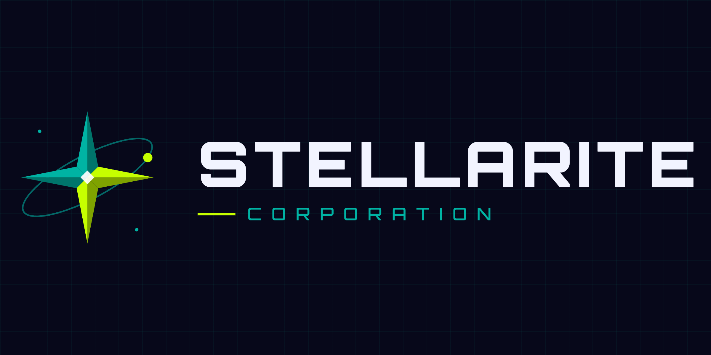
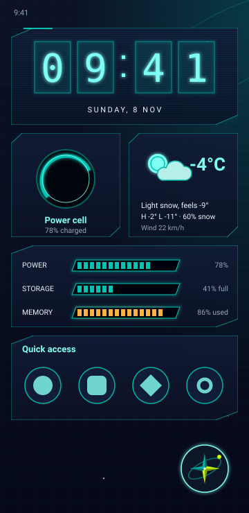
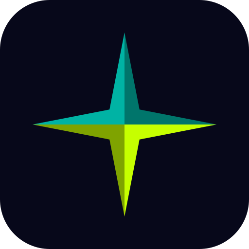

  

<h1 align="center">CyberSkinOS</h1>

  A holographic space-station home screen for Android, by Stellarite Corporation.

  

---

## ✦ What it is

CyberSkinOS replaces your home screen with a ship's console. Every widget sits on a panel of projected glass with cut
corners, corner brackets and faint scan lines, over a star field with a slow orbit ring. One look, built in full: no
style switcher, nothing to configure before it looks right.

- **The Stellarite star** floats in the corner. Tap it for the **Databank** (every app, A to Z, with fuzzy search and a
  calculator), double-tap it for the **Console**, and press and hold to move it.
- **Twenty-nine widgets**, all drawn as holograms: Holo clock, Time readout, Chrono dial, Power cell, Data storage, Vitals,
  Audio deck, System load, Nav bearing, Atmos pressure, Lunar phase, Daylight cycle, Atmos (weather), Orbital map,
  Stopwatch, Timer, Calendar grid, Schedule feed, Floodlight, World time, Comms, Usage log, Log (notes), Quick access,
  Data folder, Link cache, Priority apps, and widgets from your other apps.
- **Eight palettes** (Stellarite, Cobalt, Nebula, Pulsar, Solar, Ice, Biolume, Graphite), **eight signal colours**,
  and sliders to mix your own.
- **Pages, presets and scheduled looks.** Up to eight home pages, layouts you can save and share as a text code, and
  colour schemes that switch by the clock or while charging.
- **Motion and sound**, both gentle: panels shimmer now and then, a scan line sweeps on page change, and pulse rings
  spread from the star. Sound effects are soft glassy pings, off until you switch them on.
- **Backup, restore and safe mode.** One file holds everything. If the launcher ever fails to start three times, it
  starts clean and keeps a rescue copy.

## 📲 Install

1. Download the latest `CyberSkinOS-vX.Y.Z.apk` from the [Releases](../../releases) page.
2. Open it on your phone and allow installing from your browser or file manager if Android asks.
3. Press Home and choose **CyberSkinOS**, or go to Settings > Apps > Default apps > Home app.

CyberSkinOS installs alongside other launchers, so you can switch back at any time.

## 🔐 Permissions and privacy

| Permission | Why |
|---|---|
| Notification access (optional) | Lets the Audio deck show the track, artist and progress. Off by default. |
| Notifications (optional) | Lets the Timer ring with a notification. Asked once, the first time you start one. |
| Calendar (optional) | Lets the Schedule feed list your coming events. Asked when you tap Allow, and read on the phone only. |
| Location (optional) | Lets the Daylight cycle and Atmos widgets work out where you roughly are. Asked once, only if you add them. |
| Internet (Atmos only) | Lets the Atmos widget ask open-meteo.com for the forecast. Only your location, rounded to about a kilometre, is sent. Nothing else in CyberSkinOS goes online. |
| Package queries | Lists the apps you have installed, to show them in the Databank. |

CyberSkinOS has no analytics and no accounts. Hiding an app only tidies the view; it is not a lock.

Weather data by [Open-Meteo.com](https://open-meteo.com/), used under [CC BY 4.0](https://creativecommons.org/licenses/by/4.0/).

## 🛠️ For developers

- Kotlin 2.0, Jetpack Compose (BOM 2024.09), Material 3, Android Gradle Plugin 8.5, Gradle 8.9, JDK 17.
- `minSdk 26`, `targetSdk` and `compileSdk 34`, package `com.stellarite.cyberskinos`.
- The Gradle project lives in `CyberSkinOS/`. Build with `gradle assembleDebug` from there, or push to GitHub and let
  the workflow in `.github/workflows/build-apk.yml` build it.

| File | Contents |
|---|---|
| `Launcher.kt` | The launcher, widget board, Databank, Console and Settings |
| `Components.kt` | Holo panels, buttons, icon rings, dials, digits, the star and the space backdrop |
| `Theme.kt` | Palettes, signal colours, fonts and wallpaper helpers |
| `StyleMotion.kt` | The panel shimmer and the page-change scan line |
| `Sound.kt` | Sound effects and pulse rings |
| `Look.kt` | Colour sliders and the colours saved inside presets |
| `Backup.kt` | Backup, restore, reset, the backup reminder and safe mode |
| `Weather.kt` | The Atmos widget |
| `Vials.kt` | The Vitals widget |
| `Music.kt` | The Audio deck and its notification listener |
| `Timer.kt` | The Timer widget (countdown and alarm) and its ringing |
| `Agenda.kt`, `Logbook.kt`, `Lantern.kt`, `SpeedDial.kt`, `WorldClock.kt`, `Notes.kt`, `LinkFolder.kt`, `SolarSystem.kt` | One widget each |
| `AppWidgets.kt` | Hosting widgets from other apps |
| `WidgetSettings.kt` | Per-widget settings |
| `Schedule.kt` | Scheduled looks |
| `About.kt` | Help, credits and the Stellarite mark |

- **Sounds:** seven short WAV files in `app/src/main/assets/sounds/`, generated from synthesized tones.
- **Icon:** an adaptive icon drawn as a vector from the Stellarite star, with a one-colour version for Android 13
  themed icons.
- **Releases:** bump `versionCode` and `versionName` in `CyberSkinOS/app/build.gradle.kts`, then push a tag such as
  `v1.0.1`. Tagged builds are signed with the keystore in the `KEYSTORE_BASE64`, `KEYSTORE_PASSWORD`, `KEY_ALIAS` and
  `KEY_PASSWORD` repository secrets, and published as a draft release.

---

   
  Created by Courier, of Stellarite Corporation.

